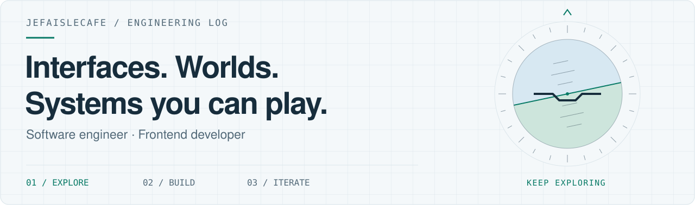
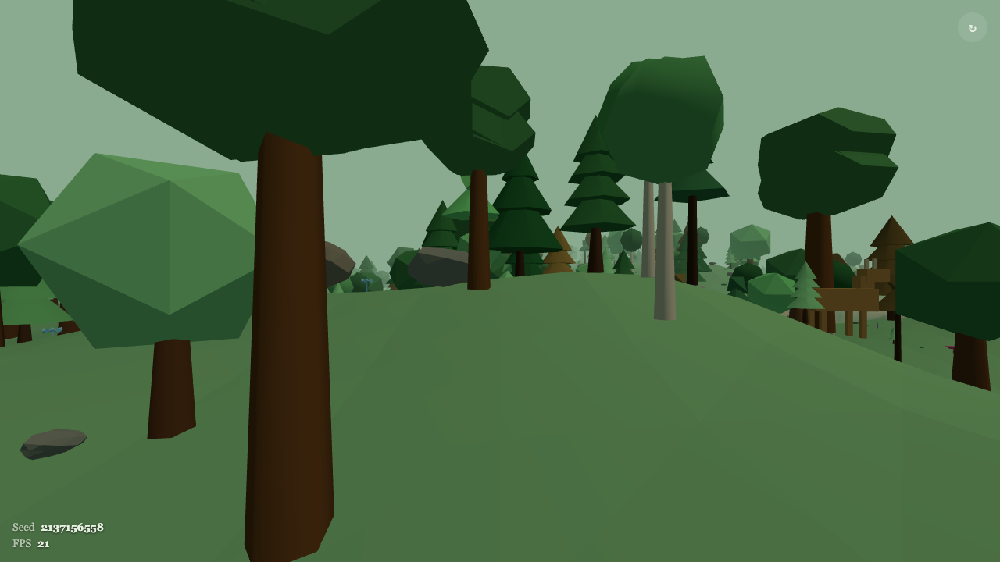
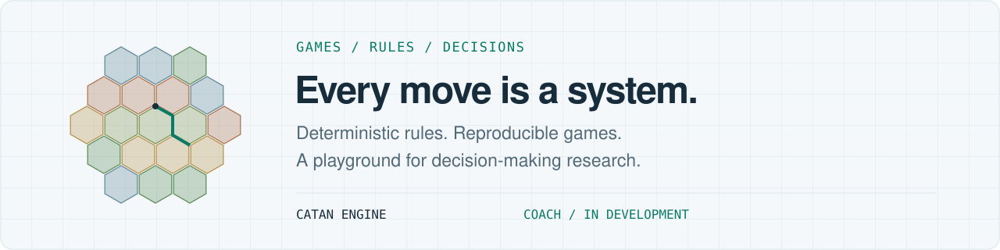

<picture>
  <source media="(prefers-color-scheme: dark)" srcset="./img/flight-deck-dark.svg">
  <source media="(prefers-color-scheme: light)" srcset="./img/flight-deck-light.svg">
  
</picture>

# Pierre-Étienne Soury · JeFaisLeCafé

**Software engineer & frontend developer.** I like turning complex systems into things you can explore, play with, and understand.

My projects range from procedural 3D worlds to game engines and interactive interfaces. Mostly TypeScript, React, and Three.js; Python when the experiment calls for it.

[LinkedIn](https://www.linkedin.com/in/pierre-etienne-soury-66050511b/) · [Explore my repositories](https://github.com/JeFaisLeCafe?tab=repositories)

## 01 / Explore a world

### Procedural forest

A low-poly forest you can walk through in your browser, with a hidden treasure to find. A new seed creates a new world.

**Under the canopy:** seeded terrain and object placement, first-person movement and collisions, growing vegetation, and distance-based audio cues.

`Three.js` `TypeScript` `Procedural generation`

[Enter the forest ↗](https://forest-demo-tawny.vercel.app) · [Read the code](https://github.com/JeFaisLeCafe/forest-demo)

## 02 / Understand the game

<picture>
  <source media="(prefers-color-scheme: dark)" srcset="./img/catan-systems-dark.svg">
  <source media="(prefers-color-scheme: light)" srcset="./img/catan-systems-light.svg">
  
</picture>

Two different ways of looking at Catan: implementing the rules, and investigating what makes a good decision.

<table>
  <tr>
    <td width="50%" valign="top">
      <h3>Catan game engine</h3>
      
A TypeScript implementation of the game, with seeded randomness, immutable state, and an event history for analysis.

      
<strong>The engineering:</strong> explicit game rules, typed state transitions, and reproducible simulations.

      
<code>TypeScript</code> <code>Game logic</code>

      
<a href="https://github.com/JeFaisLeCafe/catan-game">Explore the engine ↗</a>

    </td>
    <td width="50%" valign="top">
      <h3>Catan Coach</h3>
      
Exploring how to evaluate Catan decisions through win probability. The research foundations include baseline models and a calibration harness.

      
<strong>The engineering:</strong> separating domain logic from the game engine, and measuring prediction quality.

      
<code>Python</code> <code>AI research</code> · In development

      
<a href="https://github.com/JeFaisLeCafe/catan-coach">Follow the experiment ↗</a>

    </td>
  </tr>
</table>

## 03 / Sweat the interaction

### Holographic card effects

A React library for interactive Pokémon-style holographic cards: layered visual effects, pointer-driven tilt, and optional device-orientation input.

**The frontend work:** reusable components, a dedicated interaction hook, and configurable effects. Inspired by [Simon Goellner's Pokémon card effects](https://poke-holo.simey.me/).

`React` `TypeScript` `CSS` `Interaction design`

[Explore the library ↗](https://github.com/JeFaisLeCafe/react-pokemon-card-effect)

---

**Outside the editor:** flying planes, following esports, and occasionally turning the latter into code with projects like [LCK Elo ratings](https://github.com/JeFaisLeCafe/lck-elo-ratings).

*Je fais aussi le café.* ☕
